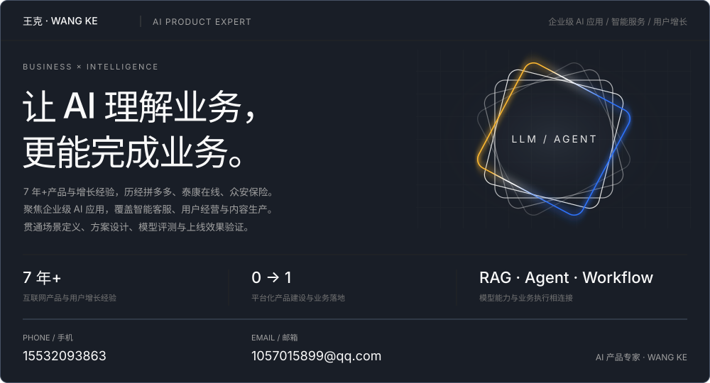
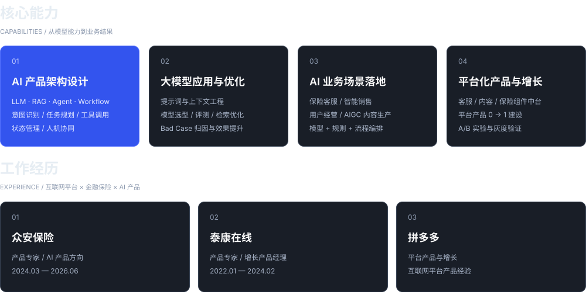
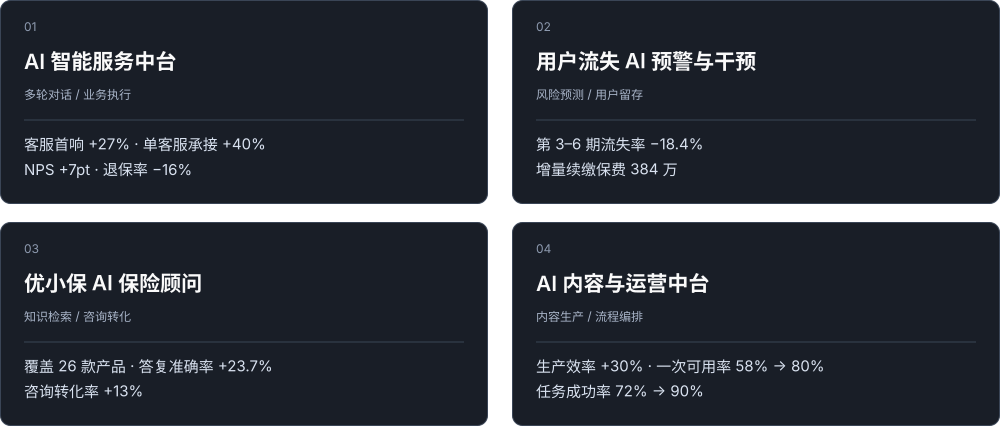

[探索项目案例 →](#代表项目)　[在线作品集 ↗](https://wangke32093863-coder.github.io/wangke-portfolio/)　[邮件联系 ↗](mailto:1057015899@qq.com)

## 代表项目

从业务场景出发，以产品效果验证 AI 价值。

[查看完整作品集 ↗](https://wangke32093863-coder.github.io/wangke-portfolio/)
